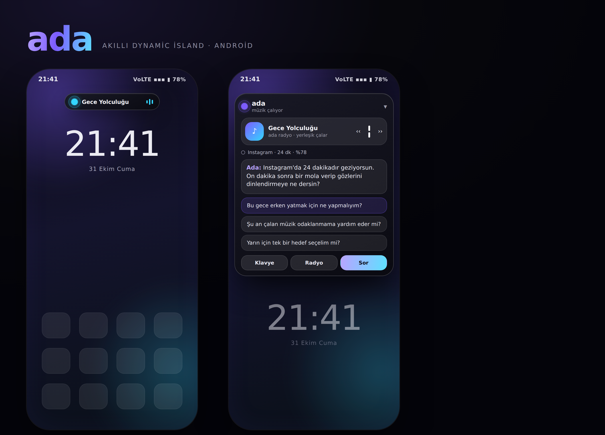

# ada — akıllı dynamic island (Android)

Ekranın en üstünde yaşayan, müziği gösterip kontrol eden, o an ne yaptığını gören ve
bağlama uygun sorular soran küçük bir yapay zekâ adası.

Telefonun kendi arayüzünü değiştirmez: diğer uygulamaların **üzerinde** duran bir
kapsül olarak çalışır (Instagram'da, Chrome'da, oyun oynarken de görünür).



---

## 1. Kurulum (2 dakika)

1. `Ada-1.11.apk` dosyasını telefona indir.
2. Dosyaya dokun. Android "bilinmeyen kaynaklara izin ver" derse, izin ver
   (Ayarlar → Uygulamalar → Özel erişim → Bilinmeyen uygulamalar → dosya yöneticisi / tarayıcı).
3. Kur → **Aç**.
4. Uygulamanın ana ekranında sırayla izinleri ver:
   - **Üstte görünme** → aç (zorunlu, ada bu izin olmadan çizilemez)
   - **Bildirim erişimi** → Ada'yı listede bul ve aç (müziği görmek/kontrol etmek için)
   - **Kullanım erişimi** → Ada'yı bul ve aç (hangi uygulamada olduğunu görmek için)
   - **Bildirim izni** → izin ver (Android 13+)
   - **Pil optimizasyonu** → kaldır (sistem adayı kapatmasın)
5. **Başlat** düğmesine bas. Ekranın üstünde `ada` kapsülü belirir.

> Ada'nın çalışması için bu izinler gerçekten gerekli: overlay (üstte çizim), bildirim
> erişimi (medya oturumu), kullanım erişimi (aktif uygulama). Bildirim dinleyicisi genel
> bildirim içeriğini okumaz; müzik kontrolü için Android'in aktif medya oturumlarına
> erişim sağlar. AI açık ve API anahtarı tanımlıysa sohbet mesajları ile aktif uygulama,
> süre, saat, pil ve müzik bağlamı seçtiğin sağlayıcıya gönderilir. AI kullanılmıyorsa
> yerleşik kural tabanlı öneriler cihazda üretilir.

## 2. Yapay zekâyı bağlama

Ada'nın soruları ve cevapları iki modda çalışır:

- **Anahtarsız (yerleşik) mod:** kurallara dayalı, bağlama duyarlı Türkçe sorular üretir
  ("Instagram'da 24 dakikadır geziyorsun…", "Batarya %18…"). Hiçbir ayar gerekmez.
- **AI modu:** ana ekranda sağlayıcı olarak **Google Gemini API** seç veya **Gemini 3.8 Flash ayarlarını uygula** düğmesine dokun. Google AI Studio'dan aldığın kendi API anahtarını gir; model `gemini-3.8-flash` olarak ayarlanır.
- Gemini yanıtları SSE akışıyla parça parça gösterilir; yanıtın tamamlanmasını beklemeden yazı görünmeye başlar. Sohbet, arka plandaki soru-öneri isteğini beklemez. Gerçek süre internet ve API yanıtına bağlıdır.
- API anahtarı yoksa sohbet Gemini yanıtı üretemez; kapsüldeki öneriler cihazda çalışan basit kurallara döner.
- **Kaydet ve test et** hata verirse, sağlayıcının okunabilir hata açıklaması ekranda gösterilir. `gemini-3.8-flash` geçerli kararlı model kimliğidir; sorun sürerse anahtar, Google AI Studio projesi, API erişimi veya kota durumunu bu hata metnine göre kontrol et. Anahtarın kendisini kimseyle paylaşma.
- Diğer sağlayıcılar için **OpenAI uyumlu servis** seçeneğini kullan:

| Servis | Sunucu adresi | Model örneği |
| --- | --- | --- |
| OpenAI | `https://api.openai.com/v1` | `gpt-4o-mini` |
| Groq | `https://api.groq.com/openai/v1` | `llama-3.3-70b-versatile` |
| OpenRouter | `https://openrouter.ai/api/v1` | `openai/gpt-4o-mini` |
| Yerel (LM Studio/Ollama) | `http://192.168.1.x:1234/v1` | model adı |

**Kaydet ve test et** → "✓" görürsen bağlantı tamam. Anahtar cihazda saklanır,
yalnızca seçtiğin adrese gider.

> Gemini API anahtarını sohbete veya herkese açık depoya koyma. Google, mobil uygulamalardaki anahtarların çıkarılabileceğini belirtiyor; kendi anahtarını Google Cloud/AI Studio'da yalnızca Gemini API ile kısıtla. Üretim uygulamaları için güvenli sunucu proxy'si önerilir.

YouTube araması Gemini anahtarından ayrıdır ve **YouTube Data API v3 anahtarı** ister. Anahtarı Google Cloud'da yalnızca YouTube Data API için kısıtla; mümkünse uygulama kısıtlaması kullan veya bir sunucu proxy'si tercih et. Mobil uygulamaya girilen istemci anahtarının çıkarılabileceğini unutma. VYRA-Music deposunda herkese açık kalmış eski anahtarı kullanma; onu Google Cloud'da iptal edip yenile.

## 3. Kullanım

- Ada kapsülü açılırken esneyerek büyür; içerik sırayla belirir. Müzik çalarken nota rozeti nabız gibi parlar.
- **Kapalı hâl:** küçük kapsül. Çalan şarkıyı ve canlı dalga formunu gösterir.
- **Dokun:** kart açılır — müzik, "şu an ne yapıyorsun" bilgisi, üç soru önerisi ve cevap.
- **Sürükle:** kapsülü istediğin yüksekliğe taşı (konum hatırlanır).
- **‹‹ / ▮▮ / ››** : o an çalan uygulamanın müziğini kontrol eder (Spotify, YouTube Music…).
  Hiçbir şey çalmıyorsa Ada Radyo devreye girer.
- **Spotify / YouTube ara:** Spotify araması resmî uygulamaya aktarılır. YouTube Data API anahtarı girilmişse Ada sonuçları listeler; seçtiğin video Ada'nın içindeki resmî YouTube IFrame oynatıcısında görünür kontrollerle açılır. Oynatma yalnızca Ada ekrandayken sürer; arka planda dinlemek için YouTube Music/YouTube uygulamasına geçebilirsin. Anahtar yoksa arama doğrudan resmî uygulamada yapılır.
- **Telefondan ses dosyası seç:** Android dosya seçicisinde bir veya daha fazla ses dosyası seç; Ada seçilen parçaları sırayla çalar. Tüm depolamaya erişim izni istemez.
- **Radyo:** uygulamayla gelen üç ortam parçası (Gece Yolculuğu, Derin Odak, Yağmurlu Pencere).
- **Sor:** sıradaki öneriyi sorar. **Klavye:** tam ekran sohbeti açar.
- **Kendiliğinden sorular:** ayarlardan 15/30/60 dakikada bir açılır (kilit ekranındayken susar).
- **Güncellemeler:** ana ekran açıldığında 24 saatte bir GitHub sürüm akışını denetler; **Şimdi güncelleme ara** ile elle de denetlenebilir. Geçici ağ hatası kontrol zamanlayıcısını başlatmaz. Yeni sürüm varsa indirip kurmayı sen başlatırsın. İndirilen APK'nın SHA-256 değeri doğrulanır ve Android kurulum onayı gerekir.
- Kapatmak için bildirimdeki **Gizle** veya ana ekrandaki **Başlat/Durdur**.

## 4. Nasıl çalışıyor (teknik)

| Parça | Ne yapar |
| --- | --- |
| `IslandService` | `TYPE_APPLICATION_OVERLAY` penceresi, ön plan servisi, 1 sn'lik döngü, açılma animasyonu |
| `MusicBridge` + `MusicNotificationListener` | `MediaSessionManager.getActiveSessions()` ile aktif çaları okur, `TransportControls` ile kontrol eder |
| `ContextReader` | `UsageStatsManager.queryEvents()` ile son ön plana gelen uygulama + süre, batarya, saat |
| `SuggestionEngine` | API anahtarı yokken çalışan kural tabanlı Türkçe soru üreteci |
| `AiClient` | Google Gemini `streamGenerateContent` (SSE, parça parça yanıt) ve OpenAI uyumlu `/chat/completions`, saf `HttpURLConnection` |
| `YouTubeSearchClient` | Resmî YouTube Data API v3 ile başlık/kanal arar |
| `YouTubePlayerActivity` | YouTube'un görünür IFrame oynatıcısını Ada içinde açar; ekran arka plana geçince durdurur |
| `UpdateManager` | HTTPS sürüm akışını denetler, SHA-256 doğrular ve Android PackageInstaller'a devreder |
| `LocalPlayer` | `assets/*.mp3` için Ada Radyo ve Android dosya seçicisinden kullanıcının seçtiği sesler için `MediaPlayer` kuyruğu |
| `MainActivity` / `ChatActivity` | izin merkezi, ayarlar, tam ekran sohbet |

- Java + saf Android framework; **hiçbir üçüncü parti kütüphane yok**, APK ~1 MB.
- Uygulama listesi erişimi geniş `QUERY_ALL_PACKAGES` izni yerine belirli yaygın uygulamalarla sınırlandırılmıştır.
- minSdk 26 (Android 8) – targetSdk 32 (Android 12L).
- Telefon dosyaları `ACTION_OPEN_DOCUMENT` ile kullanıcının seçtiği URI üzerinden açılır; READ_MEDIA_AUDIO, READ_EXTERNAL_STORAGE ve QUERY_ALL_PACKAGES istenmez. Sistem yine overlay ve bildirim erişimi için kullanıcı onayı ister; bu özel erişimler gizlice verilemez.
- Ses dosyaları numpy ile sentezlenip ffmpeg ile mp3'e çevrildi (`gen_audio.py`).

## 5. Kaynaktan derleme

Gereksinimler: JDK 17+, Android SDK platform 34, `aapt`, `zipalign`, `apksigner`.

```bash
export ADA_KEYSTORE_PASS='kendi-guclu-parolan'
# Gerekirse ayrı özel anahtar parolası: export ADA_KEY_PASS='...'
./build.sh          # → ada.apk
```

İmza anahtarı ve parolaları herkese açık depoya eklenmez. Yeni yerel derleme ilk çalıştırmada kendi `ada.keystore` dosyasını üretir.

Betik sırayla: `aapt package` → `javac --release 11` → `d8` (R8) → `zipalign` → `apksigner`.
(Klasik Gradle'a gerek yok; tek dosyalık bir derleme hattı.)

```
AndroidManifest.xml
res/                      simge, tema, renkler
assets/                   üç ortam parçası (mp3)
src/com/ada/island/       Java kaynakları
build.sh                  derleme hattı
gen_audio.py              ses üretimi
mockup/preview.html       tasarım önizlemesi
```

## 6. Bilinen sınırlamalar

- Android 8'in altında çalışmaz. MIUI/ColorOS gibi arayüzlerde "otomatik başlatma" ve
  "arka planda çalışma" izinlerini de açmak gerekebilir.
- Bildirim erişimi verilmezse ada müziği **göremez** (kendi radyosunu yine çalar).
- Kullanım erişimi verilmezse "hangi uygulamadasın" bilgisi "Ana ekran" kalır.
- Spotify/YouTube içeriklerini Ada içinden indirmez veya akış korumalarını aşmaz. YouTube videosu yalnızca görünür resmî oynatıcıda gösterilir; Ada arka plana geçince oynatma durur. Arka plan çalma için YouTube uygulamasına geçilir; yerel olarak seçtiğin ses dosyaları Ada'da çalınır.
- Güncelleme için Android'de Ada'ya **bu kaynaktan uygulama yükleme** özel erişimi vermen gerekebilir. Bu erişim yalnızca güncelleme akışında istenir. APK yüklemesini Android tamamlar ve sistem onayı gösterir; sessiz kurulum veya sistem güvenliğini atlama yoktur.
- Güncelleme akışı HTTPS üzerinden sürüm bilgisini okur; indirmeden sonra SHA-256, uygulama kimliği ve sürüm numarası doğrulanır. Android yükleme kaynağı izni isteyebilir ve her kurulumda kendi onay ekranını gösterir; sessiz kurulum yapılmaz.
- Herkese açık kaynak deposundaki derleme betiği kendi yerel imza anahtarını oluşturur. Bu şekilde derlenen APK, önceden yüklenmiş resmi sürümlerin yerine güncellenemez; resmi sürümler aynı özel imza anahtarıyla yayımlanır ve anahtar depoda paylaşılmaz.
- Ada, YouTube aramasında yalnızca resmî arama metaverisini alır ve videoyu YouTube'un resmî IFrame oynatıcısıyla görünür biçimde gösterir. AI yanıtı istenirse yalnızca yapılandırdığın uç noktaya istek gönderir.
